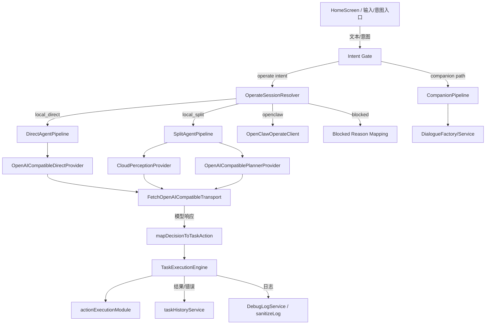

# NoNo Runtime 通道改造（完整性评审）- 架构与工程结构审查版

日期：2026-08-19\
评审对象：`2026-08-19-nono-runtime-channel-refactor.md`\
目标：给下一位接手模型一份“不是临时补丁风格”的可执行、清晰、可维护实现蓝图。

## 1. 结论

该计划的目标和拆分方向是正确的（Companion / Direct / Split / OpenClaw 四层并存），但当前仓库状态不足以直接按 Task 2/3 继续推进。\
在当前分支，`agentRuntime` 生产目录尚未创建，**Task 1 是绝对阻塞前置**；不先补齐将导致后续代码像“堆接线”而非架构化实现。

更重要的是，当前版本与计划在以下方面存在“结构性不连续”：
- 数据契约与持久化字段不一致（`AIModel` 没有 `secretRef` / `secretRefAlias`）；
- 运行时入口仍是单模型单通道；
- 日志脱敏层尚未接入；
- 页面与任务执行入口依赖的模型语义未统一。

所以：**不是改 2-3 个文件能结束，而是要按“分层契约先行”的方式一次搭通整条链**。

---

## 2. 推荐完整架构（不是“补丁式”）

### 2.1 分层边界（强制）

### 2.2 文件职责（建议稳定命名）

- `core/engine/agentRuntime/contracts`：纯类型与错误码，不关心平台/模型厂商。
- `core/engine/agentRuntime/providers`：模型协议适配，负责 `observe/decide/plan` 与鉴权/错误映射。
- `core/engine/agentRuntime/pipelines`：组合逻辑（Direct + Split）
- `core/engine/agentRuntime/session`：路由与模型连接映射（`resolveOperateSession` + `modelToConnection`）
- `core/engine/agentRuntime/session/taskLock`（新增）：任务进行时通道锁状态管理（可单独文件）
- `core/engine/agentRuntime/session/mapDecisionToTaskAction`：决策→执行器动作映射
- `core/engine/companion`：纯对话 pipeline（不触碰 screenshot/action）
- `core/engine/openclaw`：接口先行，`isConnected()` first-class 返回
- `core/engine/privacy`：`sanitizeLog` + 敏感字段规则
- `features/task`：只做入口组装与路由调用，不内嵌供应商逻辑

---

## 3. 完整性审查：计划是否“闭环”？

### 3.1 功能闭环

**有，但目前缺口：**

1) 路由闭环目前只在文档层面，生产层还无实现；
2) Companion 与操作并行运行逻辑尚未形成互斥约束；
3) Errand 尚未接入；
4) OpenClaw 需明确“未接通即 blocked，不可无感降级”；
5) 日志脱敏只写了要求，没有实装。

### 3.2 工程闭环（可维护性）

**高优先完整性要求（缺一不可）**

- 单一入口：`TaskExecutionHeadless` 与 `useTaskExecution` 均必须走同一个 `resolveOperateSession`。\
  否则同样的任务在前/后台不同行为是工程技术债。
- 错误码统一：所有 provider/transport 的错误必须是 `AgentProviderError` 及固定 `AgentErrorCode`；跨层不要再拼人类文案。
- 模型连接解析统一：`modelToConnection()` 同一位置，统一处理 `apiKey -> credential://model/{id}`。
- 历史与隐私边界：split 模式历史记录不放截图 URI；companion 不放截图或动作。
- 日志脱敏统一：`DebugLogService` 不直接写原始消息，统一调用 `sanitizeLog()`。

---

## 4. 合理性建议（针对“会不会一团糟”）

### 4.1 数据结构设计

建议把 `AIModel` 扩展策略设计为“**兼容字段优先 + 逐步迁移**”：
- 第一阶段不改 storage schema：
  - `secretRef` 缺失时返回 `credential://model/${id}`；
  - CredentialResolver 仍从 `modelService.getModelById` 获取 `apiKey`；
- 第二阶段再有后台 migration（如需要）再落地 `secretRef`。

### 4.2 决策映射安全

`mapDecisionToTaskAction` 不要“尽可能尝试执行”，而是：
- 只有显式合法参数才执行；
- 缺字段直接 fail 并终止（不会默认填充危险行为）；
- `risk === high` 仅设置 `requiresConfirmation` 不绕过。

### 4.3 失败行为标准化

建议统一三类失败语义：
- `session_blocked`：业务阻塞（能力/模式/模型未配）；
- `credential_unavailable`：鉴权不可恢复；
- `vision_unavailable`：仅在本地视觉场景触发且明确终止，不 fallback。

---

## 5. “非最小改动”的执行顺序（推荐）

下面是“完整而不混乱”的顺序（每一步有明确产出）：

### Phase A：基础契约层
- 新建 `agentRuntime/contracts`、`domain`、`providers`、`pipelines`
- 让现有 4 个 `agentRuntime` 套件从红变绿（先过红测）
- 同步新增 `OpenAICompatibleTransport` 命名一致性与错误码稳定

### Phase B：session 路由层
- 新建 `OperateSessionResolver` + `modelToConnection`
- 加入任务进行中锁 `task_in_progress_mode_locked`\
  - 覆盖 front/back 两路径测试
- 增加 `TaskExecutionEngine` 的 channel 注入，不再直接持有 `model`

### Phase C：执行链重构
- 前台/后台统一调用同一 resolver 接口
- split 映射为 `TaskAction`（集中在 `mapDecisionToTaskAction.ts`）
- 只保留 `local_direct` 先跑通，split/openclaw 明确 blocked 处理

### Phase D：Companion + Errand + OpenClaw
- 独立 pipeline，不共享 screenshot/action 代码
- errand 采用 AppState 前台扫时触发 + 明确“进程杀死漏触发”边界
- OpenClaw 仅留接口骨架，`isConnected=false` 时不 fallback

### Phase E：隐私&可观测
- 实装 `sanitizeLog`
- 全局日志写入统一 sanitization
- 补齐 plan 现有验收点（API Key, data URI 不落盘）

---

## 6. 关键风险（建议提前决策）

1. **是否允许 `draftMode` 参与路由？**\
   建议严格不参与运行路由，仅作为界面预览状态。
2. **openclaw 与 phoneOperate 冲突决策顺序**\
   建议保持文档中的最高优先级：`openclaw` > `phoneOperate` > 模式。
3. **本地视觉能力检测失败的语义**\
   建议统一为 failed-blocked（禁止 fallback）；并明确任务失败文案。
4. **Companion 误截图防线**\
   以“操作口令 + 确认”双门槛，减少误分流。

---

## 7. 验收定义（可直接用于下一模型验收）

- 红绿标准：
  - `agentRuntime` 4 套件：PASS
  - `direct/split` 通道与 headless/foreground 一致性：PASS
  - `task_in_progress_mode_locked`：前后台均覆盖
  - 本地视觉失败不回退云端：PASS
  - OpenClaw 开启时不 fallback：PASS
  - DebugLog 无 `sk-`、`Bearer` 明文、`data:image`：PASS
- 真机验收：
  - 仅 companion 时不截图；
  - 缺 unified/missing split/local planner 的 blocked 分支文案正确；
  - 开关能力后未重排进行中任务通道（锁生效）；
  - openclaw 未接通时操作受阻且 companion 不受影响。

---

## 8. 一句话结论

这份计划值得保留其主线，但建议把实现路径改为“先结构、后行为”，按上面的分层边界一次性搭好执行链，而不是跳到中间 Task 做局部修补。\
这样你交给后续模型的不是“散点修补清单”，而是**有固定接口、有统一错误模型、有可回归测试的工程级实现**。
