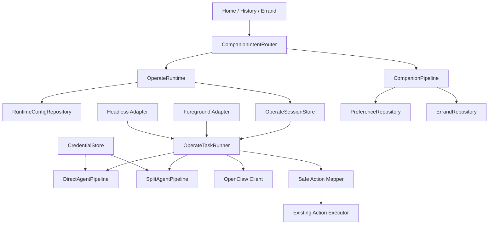

# NoNo Runtime 通道与任务会话重构设计

日期：2026-08-19

## 1. 目标

NoNo 同时支持四类运行能力：陪伴对话、手机操作、交代任务和 OpenClaw。它们共享配置与用户入口，但不能共享不受约束的执行状态。

本设计建立以下不变量：

1. 一个操作任务从创建到终态只属于一个不可变通道。
2. 前台、Headless、交代恢复消费同一个持久 session，不重新读取当前模式选路。
3. Companion 永不截图或执行设备动作。
4. 本地视觉失败绝不回退云端视觉。
5. 模型密钥不进入 AsyncStorage、React state、Headless taskData、日志或任务记录。
6. 操作模型输出必须经过结构校验、隐私投影和坐标安全映射。
7. 偏好与交代使用不同仓储和生命周期。

## 2. 当前问题

当前代码存在三套执行职责：

- `useTaskExecution.ts` 自己截图、调用模型并执行动作；
- `TaskExecutionHeadless.ts` 重复一套后台循环；
- `TaskExecutionEngine.ts` 又维护一套执行循环和生命周期。

此外，模型对象整体保存在 AsyncStorage，后台入口还会把包含 `apiKey` 的模型对象序列化进 `taskData`。能力、模式、OpenClaw、模型列表和选中状态分散在多个 key 中，无法形成一致的路由快照。

## 3. 总体架构



### 3.1 唯一执行所有者

`OperateTaskRunner` 是唯一拥有“截图 → 推理 → 决策 → 确认 → 动作 → 下一步”循环的模块。

- Foreground adapter：创建 taskId/session、绑定 UI callback、调用 runner。
- Headless adapter：只解析 `{taskId, sessionRevision}`、claim session、绑定 native lifecycle、调用 runner。
- `TaskExecutionEngine`：重构为 runner 内部的 legacy action/history adapter，不能再独立选择模型或启动第二套循环。
- Hook、Screen、Headless 文件不得直接 import provider、`modelInferenceModule` 或动作循环。

指令不进入 Headless payload，也不复制进 session。Foreground/Errand 先写现有用户可见任务记录；runner 通过 `TaskInstructionPort.load(taskId)` 读取该任务的 instruction。找不到记录时以 `session_not_found` 终止，不从 UI/global/current-task 状态猜测。

### 3.2 配置快照

新增单一 `RuntimeConfigEnvelopeV1`：

```ts
interface RuntimeConfigEnvelopeV1 {
  schemaVersion: 1;
  revision: number;
  capabilities: CapabilityFlags;
  activeMode: AgentModeId;
  draftMode: AgentModeId;
  selectedModels: Record<ModelListKey, string | null>;
  openclaw: OpenClawConfig;
}
```

所有影响运行时路由的写入必须通过 `RuntimeConfigRepository.mutate()`，在一次 AsyncStorage `setItem` 中保存整个 envelope 并递增 revision。旧分散 key 在迁移完成前只作为导入源；运行时不得混读新旧 key。

### 3.3 不可变操作会话

```ts
interface RuntimeModelBinding {
  list: ModelListKey;
  modelId: string;
  providerId: string;
  baseUrl: string;
  modelName: string;
  maxSteps: number;
  capabilities: ModelCapabilities;
  secretRef: string;
}

interface ResolvedOperateSessionV1 {
  schemaVersion: 1;
  taskId: string;
  sessionRevision: number;
  configRevision: number;
  channel: 'cloud_direct' | 'cloud_split' | 'local_vision_cloud_planner' | 'openclaw';
  bindings: {
    direct?: RuntimeModelBinding;
    vision?: RuntimeModelBinding;
    planner?: RuntimeModelBinding;
  };
  localVision: boolean;
  openClawRef?: {gateway: string; deviceId: string; cluster: string};
  createdAtMs: number;
}
```

会话固定 endpoint、模型名、能力和 maxSteps。密钥只保存 `secretRef`，每个网络请求前解析。模型被编辑或删除不会改变已开始任务；密钥轮换可以立即生效。

`OperateSessionStore` 使用一个版本化 envelope key 保存 active session、lease generation 和 bounded terminal tombstones。所有 JS 变更经进程级串行队列提交；同一 taskId 的重复 claim/terminal/release 幂等。由于 AsyncStorage 不提供跨进程 CAS，本设计不宣称数据库级原子性；Android service 与 RN execution 的唯一 owner 仍由现有 native/session lifecycle contract 保证。

### 3.4 凭证边界与迁移

新增跨平台 `CredentialStore`：

- Android：Keystore 加密后的值存 SharedPreferences；密钥材料不导出。
- iOS：Keychain Generic Password。
- JS：只暴露 `set(secretRef,value)`、`resolve(secretRef)`、`remove(secretRef)`。

模型迁移按列表逐条执行：

1. 读取旧 `AIModel.apiKey`；
2. 写入 `credential://model/{list}/{id}`；
3. 回读验证；
4. 保存无 `apiKey` 的 `StoredModelV2`；
5. 记录 migration version。

任一步失败保留旧记录且模型不可激活，不能静默清空密钥。Headless `taskData` 只允许 `{taskId, sessionRevision}`。

`StoredModelV2` 包含 `credentialState: 'ready' | 'migration_required' | 'unavailable'`。新增模型必须提供密钥；编辑模型时默认 `keep`，只有显式 `replace` 才写新密钥，显式 `remove` 会先阻止该模型处于任何 active selection，再删除 CredentialStore 项。编辑页面不能回显真实密钥。

### 3.5 Provider 与 pipeline

- `DirectAgentPipeline`：截图可进入 direct provider。
- `SplitAgentPipeline`：perception 先运行；planner 只收到 `PlannerObservation`。
- `ObservationProjection`：移除图片引用，掩码 OTP、token、卡号类文本，对 OCR/summary/history 限长。
- Provider 的结构化输出必须验证 schemaVersion、动作 discriminated union、字段长度与数字范围。
- Transport 规范化 OpenAI-compatible endpoint；AbortSignal 保持取消语义，其他错误映射到固定错误码和固定安全 message。

### 3.6 坐标与动作安全

```ts
interface CoordinateSpace {
  screenshot: {width: number; height: number; rotation: 0 | 90 | 180 | 270};
  viewport: {width: number; height: number; insetTop: number; insetBottom: number};
}
```

Observation bbox 固定为截图空间 `[x,y,width,height]`。Mapper 负责旋转、缩放和 inset 变换，拒绝：未知 target、disabled、confidence `< 0.70`、非有限数字、非正尺寸、越界坐标和缺少动作参数。高风险动作沿用既有确认机制。

### 3.7 数据分类

| 数据 | 是否可持久化 | 规则 |
|---|---:|---|
| 用户确认的偏好/称呼 | 是 | 仅写 PreferenceRepository |
| 用户确认的交代 | 是 | 仅写 ErrandRepository |
| 用户可见任务历史摘要 | 是 | 明确保留策略；不含截图/密钥/原始模型响应 |
| Runtime history | 否 | 内存中有限条 outcome 摘要 |
| Observation/OCR | 否 | planner 投影后短暂使用 |
| 诊断日志 | 是 | 固定字段、脱敏、长度上限 |
| API Key/Authorization | 仅 CredentialStore | 禁止其他位置 |

### 3.8 Companion 与交代

Companion 模型只能输出 reply 与 proposal。偏好新增、删除和交代创建必须经用户确认后分别写入 `PreferenceRepository` 或 `ErrandRepository`。

Errand 独立 schema 包含 schedule、timezone、status、leaseTaskId、leaseUntilMs、lastRunAtMs、nextDueAtMs。前台 sweep 对 due item 申请 lease 后，通过 `OperateRuntime.createSession(taskId)` 执行。once 仅成功后删除；schedule 仅成功后推进下一次时间。

### 3.9 OpenClaw

一期只定义 cancellable client，并始终报告 disconnected。开启 OpenClaw 后操作不得回退其他 pipeline，Companion 不受影响。未来 screenshot attachment 是瞬时参数，不得存入 session 或日志。

## 4. 并行开发边界

最多同时运行三个实现子代理加一个主协调代理。每个实现子代理必须在独立 worktree 和 `codex/` 分支工作，只提交自己的文件域；主协调代理按依赖 SHA cherry-pick 到集成分支。

共享热点只能由指定集成代理修改：

- `TaskExecutionEngine.ts`
- `useTaskExecution.ts`
- `useTaskExecutionWithBackground.ts`
- `TaskExecutionHeadless.ts`
- `HomeScreen.tsx`
- `ModelService.ts`
- `storage.ts`
- `NonoConfigService.ts`
- Android/iOS module registration files

新模块优先并行；共享热点按 wave 串行开放一次。

## 5. 完成标准

- 前台与 Headless 使用同一 session，配置变化不改变进行中任务。
- Headless taskData 无模型对象、API Key、指令原文和截图。
- 三套执行循环收敛为一个 runner。
- local vision 失败时 cloud perception/direct 调用数为零。
- Companion/Planner 请求均通过对应隐私边界。
- 旧模型凭证迁移可重试、失败不丢数据、成功后 AsyncStorage 无明文 key。
- Errand 并发 sweep 不重复执行。
- 全量 Jest、TypeScript、触及的 Android/iOS 构建及真机前后台/取消/恢复验收通过。
